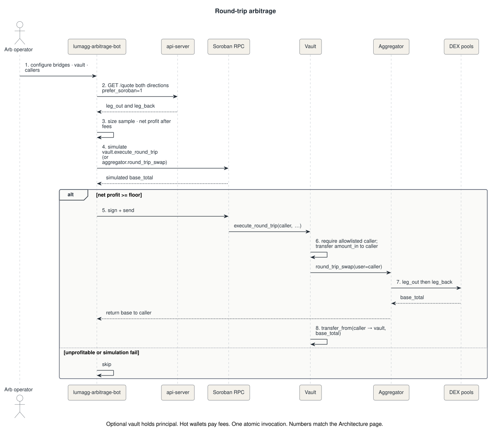
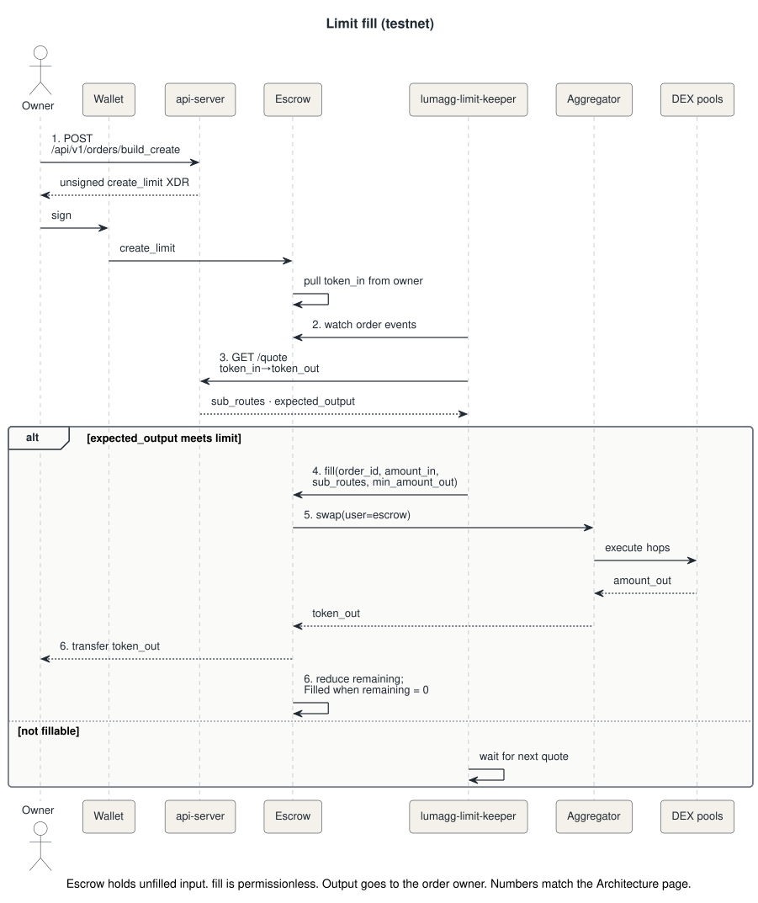

# Architecture

LumAgg is a liquidity aggregator for Stellar. The off-chain quote plane
finds an executable route across Soroban DEXes and Classic Stellar DEX.
Soroban routes run in one aggregator invocation. Classic-only routes run
as `PathPaymentStrictSend`.

The quote plane uses local AMM and CLMM math over a Redis copy of pool
state for Soroban hops. It does not call every pool on every quote.
Classic hops are quoted through Horizon PathPayment. The aggregator
contract does not keep user funds after a swap. Output returns to the
user in the same invocation.

The HTTP boundary is `lumagg-api-server`, or the embedded `lumagg-swap-api`.
Path finding, quoting, split optimization, and DEX adapters ship as in-process
libraries, not as separate network services.

Production API: `https://api.lumagg.xyz`. Swap UI: `https://lumagg.xyz`.

## Components

The implementation is these pieces.

* **Aggregator contract.** The public swap entrypoint. `swap` pulls `token_in`
  from the user, executes one or more `SubRoute`s (a simple swap is one
  entry; a split is several), checks `min_amount_out`, and sends `token_out`
  to the user. `round_trip_swap` does base → bridge → base in the same
  invocation. The contract does not retain funds after either call.
* **Vault contract.** Optional operator custody for arbitrage principal.
  Allowlisted callers run `execute_round_trip`. The vault lends `amount_in`
  to the caller, the aggregator round-trips, and the vault reclaims
  principal plus profit. It is not a retail deposit product.
* **Order escrow (testnet).** Holds unfilled `token_in` for limit and DCA
  orders. `fill` is permissionless and calls `aggregator.swap`. Output goes
  to the order owner. Do not use the testnet escrow on mainnet.
* **`lumagg-market-data-worker`.** The single writer of market state.
  Discovers pools, watches ledgers, and publishes the routing graph and
  per-pool reserves or ticks.
* **`lumagg-api-server`.** Stateless HTTP API. Quotes, builds unsigned
  transactions, optionally submits them, and serves balances, stats, and
  history. Horizontal replicas read the same Redis.
* **`lumagg-swap-api`.** One process that embeds the worker and the API with
  in-memory state. Redis is not required. Use it for private quote APIs and
  integration testing.
* **`router-engine`.** In-process PathFinder (BFS), QuoteEngine (local pool
  math), and SplitOptimizer (Brent on two paths, pairwise merge on more).
* **`dex-adapters`.** Per-venue discovery, ledger-event matching, and quote
  math for Soroswap, Aquarius (xy=k, stable, CLMM), Phoenix, Sushi V3, Comet,
  and Classic DEX via Horizon PathPayment (can be the returned route).
* **`lumagg-analytics-indexer`.** Polls aggregator (and optional escrow)
  events into SQLite. The API serves `/stats`, `/swaps`, and `/arbitrage`
  from that database.
* **`lumagg-arbitrage-bot`.** Operator scanner. Quotes both legs, simulates,
  and optionally submits `vault.execute_round_trip` or
  `aggregator.round_trip_swap`.
* **`lumagg-limit-keeper`.** Testnet operator. Watches escrow events, quotes,
  and submits `fill` when the limit is met.
* **Swap UI and `@lumagg/sdk`.** Browser UI and TypeScript client for quote
  → build → sign → submit.

System components. Clients talk to the API. The worker is the only Redis
writer. Soroban hops execute in the aggregator. Classic-only routes
execute as `PathPaymentStrictSend`.

## Terminology

* **Quote.** Off-chain computation of expected output and `sub_routes` for a
  pair and `amount_in`. It is not a reservation and not an on-chain lock.
* **Sub-route.** One executable leg: an `amount_in` and an ordered list of
  hops (`SwapStep`: pool, DEX type, tokens, indices). Several sub-routes
  with the same `token_out` are a split.
* **Split.** One swap that sends input down two or more paths in a single
  `aggregator.swap` call. The optimizer splits only when price impact or
  competing paths warrant it.
* **Routing graph.** Token pairs, pool addresses, fee tiers, and CLMM
  references. Topology only. No reserves or ticks.
* **Pool state.** Live xy=k reserves, Aquarius multi-token state, Comet
  weights, or CLMM slot0 plus ticks. Stored under `lumagg:pool:*`.
* **Hydrate.** Per-quote Redis `MGET` of pool keys on candidate paths. The
  API does not keep a long-lived in-process pool cache.
* **Round-trip.** Atomic base → bridge → base. `leg_out` amounts are
  absolute. `leg_back` amounts are weights, rescaled to the actual bridge
  output after `leg_out`.
* **Vault caller.** An allowlisted G-address that may execute round-trips
  with vault capital. It pays Soroban fees. It does not withdraw freely.
* **Escrow fill.** Permissionless call that spends escrowed `token_in`
  through `aggregator.swap` and pays `token_out` to the order owner.

## Roles

* **End user**
  * Quotes and swaps from the UI or a wallet integration.
  * Signs every swap. LumAgg never holds the user's key.
  * Receives `token_out` directly. Must hold a trustline for classic-backed
    SACs such as USDC.
  * On testnet, may create and cancel limit or DCA orders.

* **Integrator**
  * Calls `GET /api/v1/quote` and `POST /api/v1/build_tx` from a dApp, bot,
    or backend.
  * Maps `quote.sub_routes` into `build_tx`. Signs with an
    application-owned wallet adapter or the user's wallet.
  * May use `@lumagg/sdk` or the OpenAPI spec. Partner API keys raise the
    rate limit; they are not an auth boundary for swaps.

* **Self-host operator**
  * Runs `lumagg-swap-api` or the split worker + Redis + API topology.
  * Chooses RPC, TOML config, and whether to point `/build_tx` at the public
    aggregator or a self-deployed one.
  * Does not write Redis from the API process.

* **Arbitrage operator**
  * Runs `lumagg-arbitrage-bot` against a low-latency quote API.
  * May fund the vault and allowlist caller addresses.
  * Cannot withdraw vault balances unless they are the vault admin.

* **Protocol admin**
  * Initializes and upgrades the aggregator, vault, and escrow WASM.
  * On the vault: `add_caller`, `remove_caller`, `admin_withdraw`.
  * Does not sit in the quote or swap path.

## Operating model

* User swaps are non-custodial. The aggregator pulls input, executes hops,
  and returns output in one `InvokeHostFunction`. Stellar allows one host
  invocation per transaction, so every hop of a split lives in that single
  call.
* Classic Stellar DEX (Horizon PathPayment) competes with Soroban on each
  quote and can be the returned route. Mixed Classic + Soroban hops are
  dropped at quote. `/build_tx` rejects a hybrid payload. A transaction
  cannot mix Classic and Soroban operations.
* `lumagg-market-data-worker` is the only Redis writer. API replicas are
  stateless readers. Pool-key TTL (`EX=86400`) is eviction, not a freshness
  SLA. Untouched pools keep the last written value.
* CLMM ticks live in pool contract storage. The worker writes a CLMM pool
  to Redis only when tick coverage is complete. Incomplete windows are not
  shared across API instances; the quote engine skips those hops.
* The user (or their wallet adapter) signs. `/submit_tx` is an optional RPC
  proxy, not a required hop.
* The vault is operator infrastructure. There is no public withdraw for
  bots.
* Order escrow is testnet-only custody of unfilled input. It is not an
  order book and not a price oracle.

## Quote

A quote is an off-chain computation of expected output and `sub_routes`.
PathFinder walks the in-memory graph, including Classic as a single
`classic_dex` source. The API overlays Redis pool state and runs venue
math on Soroban hops. Classic hops are quoted through Horizon
`/paths/strict-send`, not local AMM math. SplitOptimizer may split
Soroban input across paths. Classic is never split.

1. The client calls `GET /api/v1/quote` with `token_in`, `token_out`,
   `amount_in`, and optional `slippage`, `prefer_soroban`, `max_hops`, and
   `max_splits`.
2. PathFinder returns all candidate paths on the current graph. It does not
   prune by liquidity.
3. The API loads unique pool keys for those paths from Redis in one `MGET`
   (xy=k, Aquarius, CLMM, Comet). Classic has no Redis pool key.
4. QuoteEngine quotes each path at full `amount_in`. Mixed Classic +
   Soroban hops are dropped. Soroban hops use local math; CLMM hops with
   incomplete coverage are skipped. Classic paths call Horizon
   PathPayment. Optional RPC hydrate runs only when
   `QUOTE_RPC_HYDRATE_ENABLED=true`.
5. SplitOptimizer runs on Soroban paths only: Brent's method for two
   paths, pairwise merge for more, and only when impact or competitive
   delta warrants it.
6. When both a Classic route and a Soroban route exist, the API returns
   Classic if `classic.total_expected_out > soroban.total_expected_out`;
   otherwise Soroban. `prefer_soroban=1` drops Classic before this pick.
7. The API returns `expected_output`, `minimum_output`, `is_split`, and
   `sub_routes` for `/build_tx`.

Default quotes never return mixed Classic + Soroban hops. They can return
a pure Classic route as the only executable path, or because it pays more
than Soroban.

## Swap

A swap is quote → unsigned XDR → wallet signature → submit. For Soroban
routes, `/build_tx` simulates `aggregator.swap` (one `SubRoute` for a
simple path, several for a split). Classic-only routes build
`PathPaymentStrictSend`. Hybrid Classic + Soroban is rejected. `/build_tx`
does not return XDR that failed simulation.

1. The user (or integrator) requests a quote.
2. The API returns expected output and `sub_routes`.
3. The client posts `user_public_key`, amounts, slippage, and those
   `sub_routes` to `POST /api/v1/build_tx`.
4. For Soroban routes, the API simulates `aggregator.swap` against
   Soroban RPC and attaches the footprint, auth entries, and resource
   fee. Classic-only routes skip this and build `PathPaymentStrictSend`.
5. The user signs the unsigned XDR in a wallet (Freighter or an
   application-owned adapter).
6. The signed transaction is submitted with `POST /api/v1/submit_tx` or
   any same-network Soroban RPC.
7. For Soroban routes, the aggregator pulls `token_in` from the user,
   executes every hop by CPI into the DEX pools, requires
   `total_out >= min_amount_out`, and transfers `token_out` to the user.
   For Classic-only, Stellar Core executes `PathPaymentStrictSend`.

If simulation fails (slippage, trustline, CPU budget, empty pool),
`/build_tx` returns an error and no XDR. Refresh the quote; do not retry
the same envelope.

## Pool-state refresh

Routing graph and live pool state are separate. Freshness is event-driven:
update Redis when the chain moves, or on bootstrap and discovery. There is
no periodic full-market sweep. Operator env vars and Redis key tables live
in [Pool state](pool-state-architecture.md).

1. On worker start, bootstrap seeds topology from the last snapshot, runs
   discovery, and publishes `MarketSnapshot` plus full pool state to Redis.
2. The ledger watcher polls `getLatestLedger` every 0.1s. Soroban RPC has
   no WebSocket or Geyser push.
3. For each new ledger it calls `getEvents` and intersects `contractId`
   with the known pool index (pools and routers).
4. Touched pools go to the fetch pipeline (RPC workers, then Redis).
5. xy=k, Aquarius, and Comet always write. CLMM writes only when
   `coverage.is_complete`.
6. Discovery (~600s) republishes the graph and full pool state: new pools,
   missed events, reconciliation.
7. Ledger ticks do not publish a new snapshot. The API reloads the graph
   from the last snapshot and overlays pool state on each `/quote`.

Active pools refresh within about 0.1–2s after an on-chain swap or
liquidity change. Cold pools stay on their last Redis value until the
next write.

## Round-trip arbitrage

Atomic two-leg arbitrage uses the same aggregator as user swaps, so
indexer stats count those fills on the aggregator. Trading principal can
sit in the vault so hot wallets only pay fees. Without
`ARB_VAULT_CONTRACT`, the bot calls `aggregator.round_trip_swap` and
callers must hold the float themselves.

1. The operator configures bridge tokens, base tokens, callers, and
   optional vault.
2. For each `(base, bridge)` the bot quotes both directions with
   `prefer_soroban=1`.
3. It samples size, estimates fees, and drops quotes below the net profit
   floor.
4. It simulates `vault.execute_round_trip` or `aggregator.round_trip_swap`.
5. On a passing simulation it signs and submits.
6. The vault requires an allowlisted caller, transfers `amount_in` to that
   caller, and invokes `round_trip_swap`.
7. The aggregator executes `leg_out` then `leg_back` (rescaling `leg_back`
   weights to actual bridge output) and returns base to the caller.
8. The vault `transfer_from`s `base_total` back to itself.

`min_amount_out` must be at least `amount_in`. Allowance expiry is a call
argument from the bot (`latest_ledger` plus a cushion). The vault does not
compute `sequence()+N` on-chain.

## Limit fill (testnet)

Limit and DCA orders lock input in `order-escrow`. The keeper is a
permissionless operator: anyone with a funded signer can run it. Fills
call `aggregator.swap`; output always goes to the order owner.

1. The owner builds `create_limit` through `POST /api/v1/orders/build_create`
   and signs. Escrow pulls `token_in`.
2. The keeper watches escrow events and tracks open orders.
3. It quotes `token_in` → `token_out` on the LumAgg API.
4. If expected output meets `limit_out_per_in_e7` (and quote slippage), it
   submits `fill`.
5. Escrow calls `aggregator.swap` with itself as `user`.
6. Aggregator output returns to escrow, which transfers `token_out` to the
   owner and reduces remaining input. Status becomes `Filled` at zero.

`cancel` is owner-only. `reclaim_expired` is permissionless after expiry.
DCA uses `create_dca` / `fill_dca` with a chunk size. Expired-order reclaim
in the keeper MVP is intentionally not a live path. Do not point these
contracts or scripts at mainnet.

## Functional scope

**In scope**

* Quotes and atomic swaps across Soroswap, Aquarius (xy=k, stable, CLMM),
  Phoenix, Sushi V3, and Comet.
* Multi-hop paths and split orders when they improve output.
* Unsigned transaction building with simulation, wallet signature, and
  optional submit proxy.
* Classic DEX as a benchmark and as a Classic-only route.
* Public stats, swap history, and arbitrage history from the indexer.
* Operator atomic round-trip arbitrage, with or without the vault.
* Testnet limit and DCA escrow plus keeper.

**Out of scope**

* Mixing Classic PathPayment and Soroban hops in one transaction.
* Custodial retail balances, accounts, or yield.
* Mainnet limit or DCA.
* Guaranteed quote execution. A quote can go stale between `/quote` and
  inclusion; `min_amount_out` is the on-chain guard.
* Cross-chain routing or non-Stellar venues.

## Stellar integration

Integrators talk to LumAgg over REST (`docs/openapi.yaml`) or `@lumagg/sdk`.
The API simulates and builds Soroban transactions against a configured RPC.
Wallets sign SEP-compatible XDR (Freighter and other Wallet Kit adapters).

On-chain types are shared: `DexType`, `SwapStep`, `SubRoute` in
`contracts/shared-types`. Venues are Aquarius, SoroswapPair, Phoenix, Sushi,
and CometDex. The aggregator, vault, and escrow are ordinary Soroban
contracts with admin upgrade.

Off-chain market state is Redis: `lumagg:snapshot:*` for the graph,
`lumagg:pool:*` for live pool state, `lumagg:snapshot:events` for API
hot-reload. Embedded `lumagg-swap-api` keeps the same interfaces in memory.

## Where to go next

| Need | Doc |
| --- | --- |
| Quote → build → sign → submit | [Integrator guide](integrator-guide.md) |
| Redis keys, env, fetch pipeline | [Pool state](pool-state-architecture.md) |
| Which binary to run | [Deployment overview](deployment-overview.md) |
| Aggregator and vault deploy | [Smart contracts](contracts-deployment.md) |
| Arb operator stack | [Arbitrage deployment](arbitrage-deployment.md), [Round-trip arbitrage](round-trip-arb.md) |
| Testnet limits | [Limit orders on testnet](limit-orders-testnet.md) |
| Indexer | [Analytics indexer](analytics-indexer.md) |

PlantUML sources for the diagrams on this page are in `docs/diagrams/`.
Regenerate SVGs with `docs/diagrams/render.sh`.
