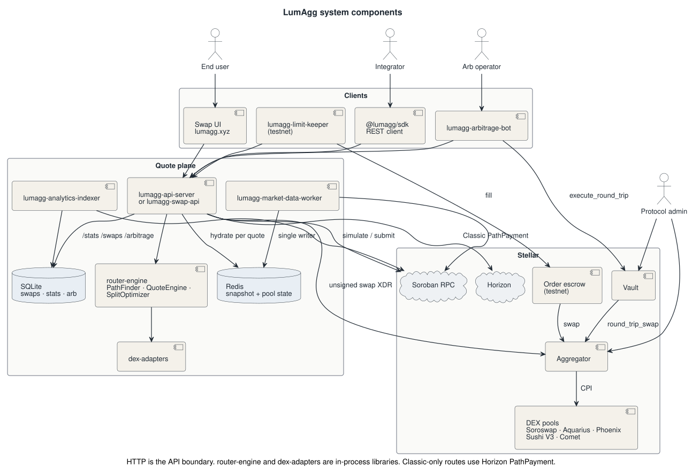
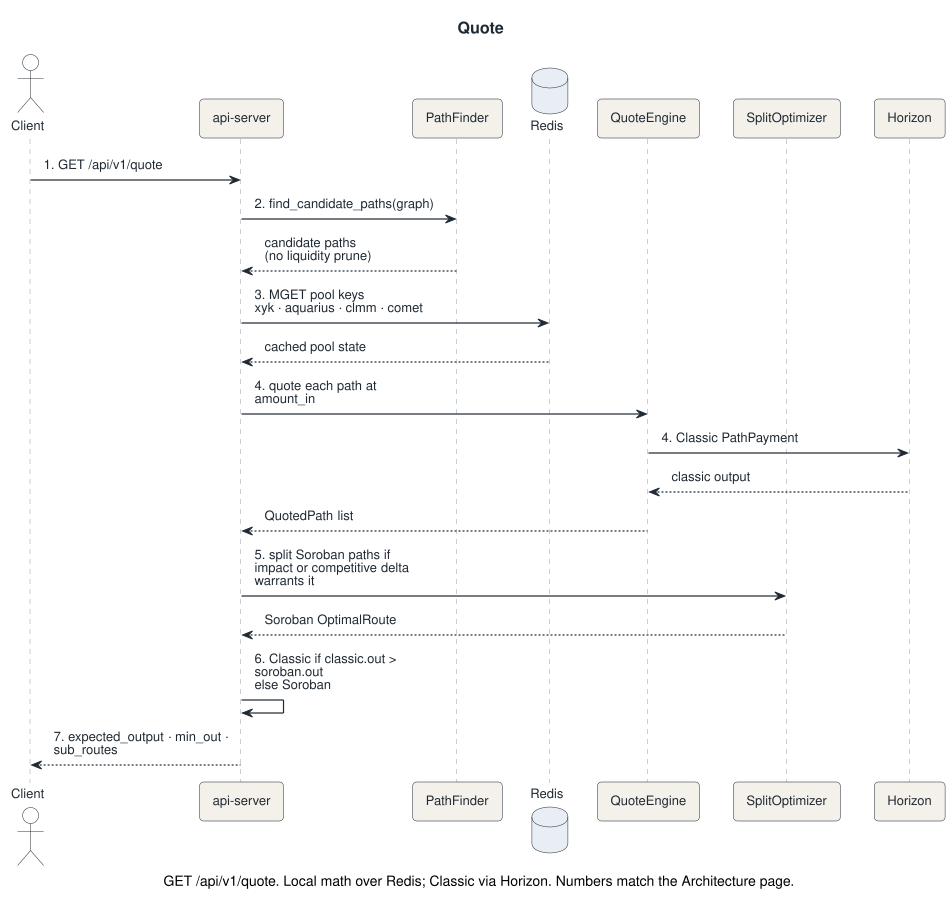
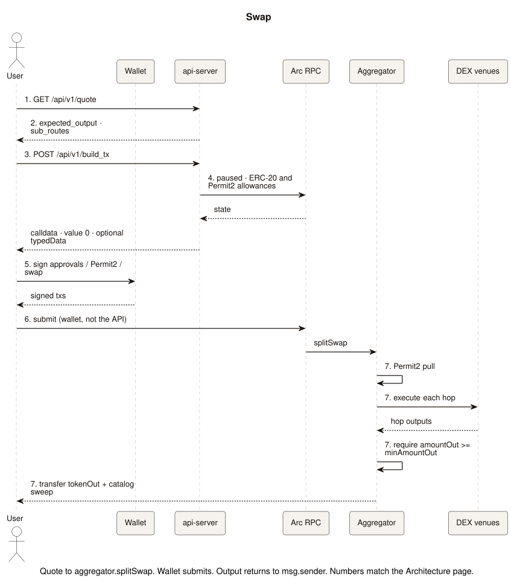
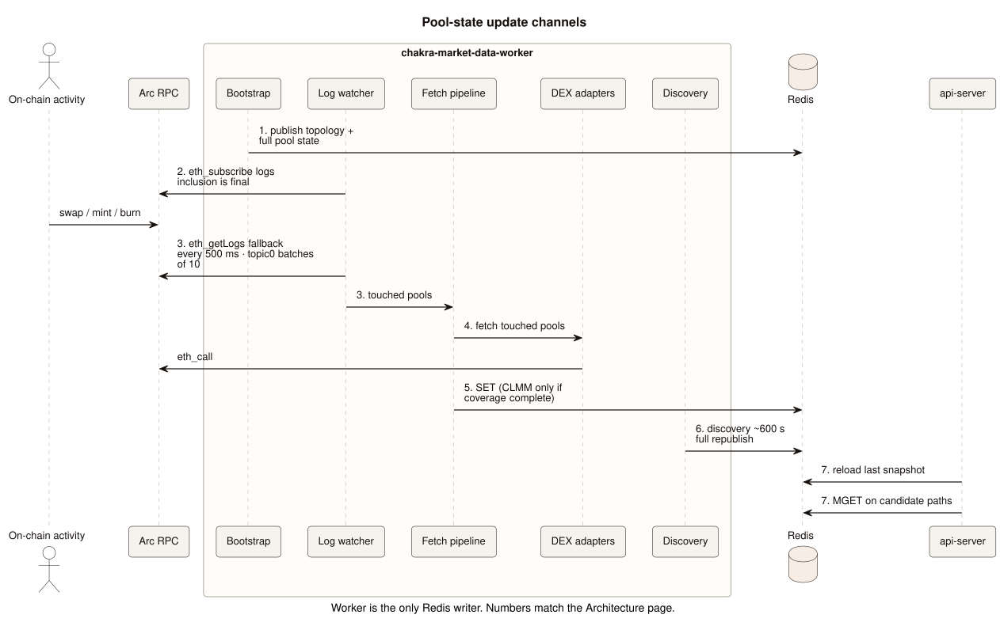

# Architecture

Chakra quotes across allowlisted Arc Testnet venues (Xylo, Presto, UnitFlow)
and executes atomically through a non-custodial Solidity aggregator
(`splitSwap`). The quote plane uses local AMM, stable-swap, and concentrated
liquidity (CLMM) math over a Redis copy of pool state. Quotes do not call
RPC. The API never holds keys and never submits. Output returns to
`msg.sender` in the same transaction.

The token catalog is ERC-20 USDC, EURC, and cirBTC. Native USDC gas is a
separate 18-decimal field and is never summed with swap USDC.

The HTTP boundary is `chakra-api-server`. Path finding, quoting, split
optimization, and DEX adapters ship as in-process libraries, not as
separate network services.

Hosted API: `https://chakra-api-0a5i.onrender.com`. Swap UI:
`https://chakra-ag.vercel.app`. Explorer: `https://testnet.arcscan.app`.

## Components

The implementation is these pieces.

* **Aggregator contract.** The public swap entrypoint. `splitSwap` pulls
  `tokenIn` from the user through Permit2, executes one or more `SubRoute`s
  (a one-path swap is one entry; a split is several), checks `minAmountOut`,
  transfers `tokenOut` to `msg.sender`, and sweeps leftover catalog tokens
  to the sender. Factory allowlist gates every hop. An empty Permit2
  signature skips `permit()`. Splits cannot share a pool. The contract
  does not retain funds after the call.
* **`chakra-market-data-worker`.** The single writer of market state.
  Discovers pools, watches Arc logs, and publishes the routing graph and
  per-pool reserves or ticks under the `chakra:` Redis prefix.
* **`chakra-api-server`.** Stateless HTTP API. Quotes, encodes unsigned
  `splitSwap` calldata, and serves tokens, balances, stats, health, and
  readiness. Horizontal replicas read the same Redis. The API does not
  submit transactions.
* **`router-engine`.** In-process PathFinder (BFS), QuoteEngine (local pool
  math), and SplitOptimizer (Brent on two paths, pairwise merge on more).
* **`dex-adapters`.** Per-venue discovery, log matching, and quote math for
  Xylo, Presto, UnitFlow V2.5 (30 bps xy=k), and generic xy=k / stable /
  CLMM factories on the seed list.
* **Redis.** Routing topology (`chakra:snapshot:*`), live pool state
  (`chakra:pool:xyk|stable|clmm:*`), factory allowlist
  (`chakra:factories`), and additive swap analytics
  (`chakra:analytics:*`).
* **Swap UI and `@chakra-ag/sdk`.** Browser UI and TypeScript client for
  quote → build → sign → submit. A public dashboard is at
  `https://chakra-ag.vercel.app/stats`.
* **Circle user-controlled SCA and Gas Station.** Grant targets. They are
  not on the live path. External wallets sign and submit today.
* **Arb-only vault and operator bot.** Grant targets. They are not on the
  live path. A future vault is a separate contract that would call
  `splitSwap` twice in one transaction. The aggregator stays
  non-upgradeable. Not retail yield.

System components. Clients talk to the API. The worker is the only Redis
writer. Hops execute in the aggregator. Circle Wallets and Gas Station are
drawn dotted: grant target, not a live path.

## Terminology

* **Quote.** Off-chain computation of expected output and `sub_routes` for a
  pair and `amount_in`. It is not a reservation and not an on-chain lock.
* **Sub-route.** One executable leg: an `amount_in` and an ordered list of
  hops (`Hop`: pool, `DexType`, tokens, fee). Several sub-routes with the
  same `tokenOut` are a split.
* **Split.** One swap that sends input down two or more paths in a single
  `splitSwap` call. The optimizer splits only when price impact or
  competing paths warrant it. Sub-routes cannot share a pool.
* **Routing graph.** Token pairs, pool addresses, fee tiers, factories, and
  CLMM references. Topology only. No reserves or ticks.
* **Pool state.** Live xy=k reserves, stable balances, or CLMM slot0 plus
  ticks. Stored under `chakra:pool:*`.
* **Hydrate.** Per-quote Redis read of pool keys on candidate paths. The
  API does not keep a long-lived in-process pool cache. `/quote` never
  calls RPC.
* **Route identity.** Token path, pool addresses, venue types, fees, and
  factories. `/build_tx` revalidates this against the current snapshot. It
  does not re-quote.
* **Permit2.** Uniswap `AllowanceTransfer` at
  `0x000000000022D473030F116dDEE9F6B43aC78BA3`. The aggregator pulls exact
  `amountIn`. Empty signature means allowance is already set.
* **`splitSwap`.** The aggregator's public swap. `value` is always `0`.
  `protocol_fee_bps` is always `0`.
* **Readiness.** `/ready` is true when `chakra:snapshot:current` exists and
  at least one `chakra:pool:*` key is present. Optional
  `CHAKRA_STRICT_READINESS` also requires a usable direct or multihop
  quote on each of the six directed catalog pairs.

## Roles

* **End user**
  * Quotes and swaps from the UI or a wallet integration.
  * Signs every approval, Permit2 message, and swap. Chakra never holds
    the user's key.
  * Receives `tokenOut` directly. Must hold the ERC-20 catalog tokens
    being swapped.
  * Pays Arc gas today. Circle Gas Station is a grant target.

* **Integrator**
  * Calls `GET /api/v1/quote` and `POST /api/v1/build_tx` from a dApp or
    backend.
  * Maps `quote.sub_routes` into `build_tx`. Signs with the user's wallet.
  * May use `@chakra-ag/sdk` or the OpenAPI spec.
  * Submits the signed transaction from the wallet. The API has no submit
    endpoint.

* **Chakra operator**
  * Runs the worker, Redis, API, and frontend. Chooses RPC from
    [Arc Testnet manifest](arc-testnet-manifest.json).
  * Manages seed factories and the aggregator allowlist.
  * Cannot sign a user transaction. Does not write Redis from the API
    process.

* **Venue operator**
  * Deploys and maintains pools. Inclusion depends on a supported adapter,
    an allowlisted factory or hub, complete market state, and usable
    liquidity.
  * Does not sit in the quote or swap path.

## Operating model

* User swaps are non-custodial. The aggregator pulls input, executes hops,
  and returns output in one Arc transaction. `msg.value` must be `0`.
  Direct ETH to the contract reverts.
* `chakra-market-data-worker` is the only Redis writer. API replicas are
  stateless readers. Pool-key TTL is eviction, not a freshness SLA.
  Untouched pools keep the last written value.
* CLMM ticks live in pool contract storage. The worker writes a CLMM pool
  to Redis only when tick coverage is complete. Incomplete windows are not
  quoted.
* `/quote` hydrates from Redis (or in-memory store) and never calls RPC.
  `/build_tx` encodes the client's `sub_routes`. It checks paused state
  and allowances on RPC. It does not compute a new route.
* A paused aggregator fails `/build_tx`. Protocol fee is `0` bps on every
  quote, including empty, single-path, and split routes.
* Catalog tokens only: ERC-20 USDC (`0x3600…0000`, 6 decimals), EURC
  (`0x89B5…D72a`, 6 decimals), cirBTC (`0xf0C4…32BF`, 8 decimals). Native
  USDC gas encoding is rejected as `token_in` / `token_out`.
* The user (or their wallet adapter) signs and submits. Circle SCA and
  Gas Station remain grant targets.

## Quote

A quote is an off-chain computation of expected output and `sub_routes`.
PathFinder walks the in-memory graph. The API overlays Redis pool state
and runs venue math on each hop. SplitOptimizer may split input across
paths. Native USDC gas is rejected before quoting.

1. The client calls `GET /api/v1/quote` with `token_in`, `token_out`,
   `amount_in`, and optional `slippage_bps`, `max_hops`, and `max_splits`.
2. The API loads the engine for the current snapshot version
   (`chakra:snapshot:current`). If the pointer moved, it reloads; if
   reload fails, it may use a stale engine.
3. PathFinder returns all candidate paths on the current graph. It does
   not prune by liquidity.
4. The API loads unique pool keys for those paths from Redis (xy=k,
   stable, CLMM) plus `chakra:factories`. This step never calls RPC.
5. QuoteEngine quotes each path at full `amount_in` with local math. CLMM
   hops with incomplete coverage are skipped. Native USDC encoding
   returns no route.
6. SplitOptimizer runs on quoted paths: Brent's method for two paths,
   pairwise merge for more, and only when impact or competitive delta
   warrants it.
7. The API returns `expected_output`, `minimum_output`, `is_split`,
   `protocol_fee_bps` (`0`), and `sub_routes` for `/build_tx`. Every
   response uses the `{success, data, error}` envelope.

A quote is not a reservation. Reserves can move between `/quote` and
inclusion. `minAmountOut` is the on-chain guard.

## Swap

A swap is quote → unsigned calldata → wallet signature → wallet submit.
`/build_tx` validates the client's `sub_routes` against the current
snapshot, checks that the aggregator is not paused, reports ERC-20
approvals to Permit2, and optionally returns Permit2 typed data. It
encodes `splitSwap`. It does not re-quote. `value` is always `"0"`.

1. The user (or integrator) requests a quote.
2. The API returns expected output and `sub_routes`.
3. The client posts `user`, amounts, `min_amount_out`, and those
   `sub_routes` to `POST /api/v1/build_tx`.
4. The API revalidates route identity, rejects a paused aggregator, reads
   ERC-20 and Permit2 allowances on RPC, and encodes `splitSwap`. If
   Permit2 allowance is already sufficient and unexpired, `typedData` is
   omitted and the encoded signature is empty.
5. The user signs required ERC-20 approvals, optional Permit2 typed data,
   and the swap transaction in a wallet.
6. The wallet submits to Arc RPC. The API does not submit.
7. The aggregator pulls `tokenIn` via Permit2, executes every hop on
   allowlisted venues, requires `amountOut >= minAmountOut`, transfers
   `tokenOut` to `msg.sender`, and sweeps leftover USDC, EURC, and cirBTC
   to the sender.

If `/build_tx` fails (paused, invalid route identity, bad catalog token,
shared pool), it returns an error and no calldata. Refresh the quote; do
not retry the same payload.

Live split **execution** on current liquidity remains unclaimed until a
confirmed split receipt exists. The optimizer may still return
`is_split: true` in quotes.

## Pool-state refresh

Routing graph and live pool state are separate. Freshness is event-driven:
update Redis when the chain moves, or on bootstrap and discovery.
Operator env vars and Redis key tables live in
[Pool state](pool-state-architecture.md).

1. On worker start, bootstrap seeds topology from the last snapshot, runs
   discovery, and publishes `MarketSnapshot` plus full pool state to
   Redis (`chakra:snapshot:*`, `chakra:pool:*`, `chakra:factories`).
2. The log watcher prefers `eth_subscribe` `"logs"` on seed and discovery
   factories plus known pools. Inclusion is final: a log touch enqueues
   an immediate fetch and Redis write.
3. When WebSocket is disabled or dead, the watcher falls back to HTTP
   `eth_getLogs` over recent blocks every 500 ms, with topic0 batches of
   at most 10 (Arc filter limit) and a catch-up cap.
4. Touched pools go to the fetch pipeline (RPC workers, then Redis).
5. xy=k and stable always write. CLMM writes only when
   `coverage.is_complete`.
6. Discovery (~600 s) republishes the graph and full pool state: new
   pools, missed events, reconciliation.
7. Ledger ticks do not publish a new snapshot. The API reloads the graph
   from the last snapshot and overlays pool state on each `/quote`.

Active pools refresh within about 500 ms to 2 s after an on-chain swap or
liquidity change. Cold pools stay on their last Redis value until the
next write.

## Functional scope

**In scope**

* Quotes and atomic swaps on Arc Testnet (chain ID `5042002`) across Xylo,
  Presto, and UnitFlow V2.5, plus generic xy=k / stable / CLMM factories
  on the seed list.
* Catalog ERC-20 USDC, EURC, and cirBTC. Permit2 pull. Factory allowlist.
* Multi-hop paths and split *optimization* when they improve output.
* Unsigned transaction building with route-identity checks, wallet
  signature, and wallet submit.
* Public stats from `chakra:analytics:*` and the `/stats` dashboard.
* Self-host: worker + Redis + API, or equivalent memory-backed topology.

**Out of scope**

* Custody, private-key handling, or API-side submit.
* Artificial liquidity or guaranteed quote execution. A quote can go
  stale between `/quote` and inclusion; `minAmountOut` is the on-chain
  guard.
* Order books, lending, limit orders, or DCA.
* Vaults or operator arbitrage (grant targets, not live).
* Cross-chain routing, CCTP, Gateway, or non-Arc venues.
* Circle user-controlled SCA and Gas Station (grant targets, not live).
* Arc mainnet. This document does not set a mainnet date.
* Claiming split *execution* on live liquidity until a confirmed split
  receipt exists.

## Arc and Circle integration

Integrators talk to Chakra over REST ([OpenAPI](openapi.yaml)) or
`@chakra-ag/sdk`. Wallets sign EIP-155 transactions and optional Permit2
typed data. The aggregator is a non-upgradeable Solidity contract on Arc
Testnet at `0xeb12351602c56d47c4ee955193335848952b29d8`.

RPC, explorer, catalog, and venue coordinates are in
[Arc Testnet manifest](arc-testnet-manifest.json): HTTP
`https://rpc.testnet.arc.io`, WebSocket `wss://rpc.testnet.arc.io`, with
Blockdaemon, dRPC, and QuickNode failovers. Do not invent Alchemy or
Canteen RPC URLs.

On-chain types are `DexType` (`Xyk`, `Stable`, `Clmm`, `Xylo`, `Presto`),
`Hop`, `SubRoute`, and `Permit2Pull` in `Aggregator.sol`. Off-chain
market state is Redis under `chakra:`.

Circle Wallets (user-controlled smart contract account on `ARC-TESTNET`)
and Gas Station are grant work. They consume the same `to`, `data`,
`chain_id`, `value`, and authorization fields `/build_tx` already
returns. They do not change the router.

An arb-only vault and operator bot are also grant work. The vault would
be a separate contract; the aggregator stays non-upgradeable. Two
`splitSwap` calls in one transaction keep isolated USDC/EURC venues
aligned. That is not retail yield and not Circle StableFX.

## Current vs grant

The live system is an Arc Testnet proof of concept: public API, UI, SDK,
worker, Redis, aggregator, and external-wallet settlement. Circle SCA,
Gas Station, and an arb-only vault/operator bot are grant targets, not
live. Proven split execution on live liquidity is not delivered. Arc
mainnet is an external gate, not a date this document sets.

The Circle Developer Grant proposal is
[Circle developer grant proposal](grants/circle-developer-grant-proposal.md).
That document is not the architecture source of truth.

## Where to go next

| Need | Doc |
| --- | --- |
| Quote → build → sign → submit | [Integrator guide](integrator-guide.md) |
| Redis keys, env, fetch pipeline | [Pool state](pool-state-architecture.md) |
| HTTP contract | [API reference](api-reference.md), [OpenAPI](openapi.yaml) |
| Which binary to run | [Deployment overview](deployment-overview.md) |
| Chain, catalog, venues | [Arc Testnet manifest](arc-testnet-manifest.json) |
| Grant companion | [Circle developer grant proposal](grants/circle-developer-grant-proposal.md) |

PlantUML sources for the diagrams on this page are in `docs/diagrams/`.
Regenerate SVG and PNG with `docs/diagrams/render.sh`. A shareable Word
export with embedded diagrams is
[Chakra-Technical-Architecture.docx](Chakra-Technical-Architecture.docx).
